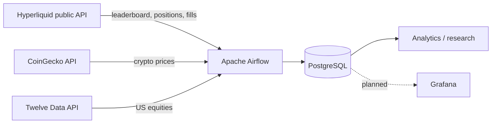
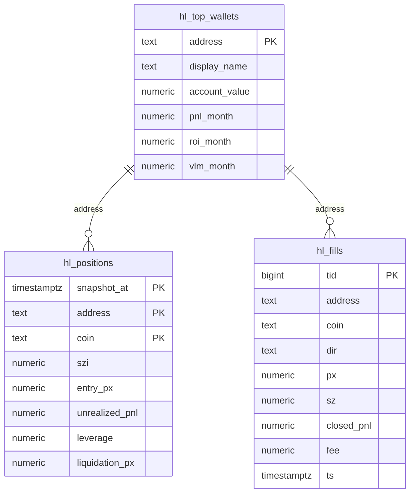

<div align="center">

# DeepWhale

### Follow the money on Hyperliquid.

An open data platform for tracking the most profitable wallets on Hyperliquid — their positions, fills, PnL and long/short behaviour — built for research and following-strategy experiments.

[Русская версия](README.ru.md)


</div>

---

## Why DeepWhale?

Hyperliquid is one of the few crypto venues where **the entire order flow is public**. Wallets are pseudonymous, but their positions and trades are visible on-chain. That creates a rare opportunity:

- see what the best traders are actually doing;
- measure their performance instead of guessing;
- compare live positioning with price action;
- build and test **following strategies** on real, timestamped data.

DeepWhale turns raw public API responses into a clean, queryable warehouse and an analytics layer.

> This is a research project, not financial advice.

## What you can do

- **Discover** the top wallets by monthly PnL and account value.
- **Track** their open positions: size, direction, entry price, unrealized PnL, leverage, liquidation price.
- **Analyse** their fills: realised PnL, volume, win rate, trade direction.
- **Compare** whale behaviour with market prices from CoinGecko.
- **Research** long/short crowding, wallet concentration and following-strategy returns.

## Architecture



Airflow runs the ingestion DAGs. PostgreSQL is the single source of truth. Grafana will become the presentation layer.

## Pipelines

| DAG | Schedule | Source | Target | Purpose |
|---|---|---|---|---|
| `wallets_snapshot` | daily, `0 0 * * *` | Hyperliquid leaderboard | `hl_top_wallets` | select top 10 wallets by monthly PnL |
| `positions_snapshot` | every 5 min | `clearinghouseState` | `hl_positions` | snapshot current open positions for top 10 wallets |
| `fills_snapshot` | every 5 min | `userFillsByTime` | `hl_fills` | incremental fills for top 5 wallets |
| `crypto_snapshot` | every 5 min | CoinGecko | `coin_snapshot` | BTC / ETH / BNB / GRAM market snapshots |
| `stock_snapshot` | every 10 min | Twelve Data | `stock_snapshot` | US equities with NYSE calendar gate |

Fills are loaded incrementally: the DAG reads `max(ts)` per wallet, subtracts a 60-second overlap and deduplicates by Hyperliquid `tid`. Positions are snapshot-based: each run writes a new state for every open position.

## Database schema



### Tables

| Table | Grain | Responsibility |
|---|---|---|
| `hl_top_wallets` | one row per wallet | current monthly leaderboard selection: identity, equity, PnL, ROI, volume |
| `hl_positions` | wallet × coin × snapshot | current risk: size, side (from `szi`), entry, uPnL, leverage, liquidation |
| `hl_fills` | one row per fill | immutable trade log: direction, price, size, realised PnL, fee, time |

The model is in **3NF**: no derived `side`, `rank`, `position_value` or `roe` columns — those are calculated in queries. `hl_positions` and `hl_fills` have foreign keys to `hl_top_wallets`.

<details>
<summary><strong>SQL DDL</strong></summary>

```sql
CREATE TABLE hl_top_wallets (
    address        text PRIMARY KEY,
    display_name   text,
    account_value  numeric(30, 6),
    pnl_month      numeric(30, 6),
    roi_month      numeric(20, 10),
    vlm_month      numeric(30, 6)
);

CREATE TABLE hl_positions (
    snapshot_at     timestamptz NOT NULL,
    address         text NOT NULL
                    REFERENCES hl_top_wallets(address) ON DELETE CASCADE,
    coin            text NOT NULL,
    szi             numeric(30, 10),
    entry_px        numeric(30, 10),
    unrealized_pnl  numeric(30, 6),
    leverage        numeric(10, 2),
    liquidation_px  numeric(30, 10),
    PRIMARY KEY (snapshot_at, address, coin)
);

CREATE TABLE hl_fills (
    tid          bigint PRIMARY KEY,
    address      text NOT NULL
                 REFERENCES hl_top_wallets(address) ON DELETE CASCADE,
    coin         text NOT NULL,
    dir          text,
    px           numeric(30, 10),
    sz           numeric(30, 10),
    closed_pnl   numeric(30, 6),
    fee          numeric(30, 6),
    ts           timestamptz NOT NULL
);

CREATE INDEX hl_fills_coin_ts_idx
    ON hl_fills (coin, ts DESC);

CREATE INDEX hl_fills_address_ts_idx
    ON hl_fills (address, ts DESC);

CREATE INDEX hl_positions_coin_snapshot_idx
    ON hl_positions (coin, snapshot_at DESC);
```

</details>

Supporting market-data tables: `coins` + `coin_snapshot` for CoinGecko, `stocks` + `stock_snapshot` for US equities.

## Stack

| Layer | Tools |
|---|---|
| Orchestration | Apache Airflow 3.3.2 |
| Language | Python 3.14 |
| Storage | PostgreSQL |
| Sources | Hyperliquid API, CoinGecko API, Twelve Data API |
| Analytics | SQL, window functions, dimensional modelling |
| Visualisation | Grafana (planned) |
| Tooling | Git, psql, Airflow UI |

## Quick start

Requirements: Python 3.14, Apache Airflow 3.x with the PostgreSQL provider, and a running PostgreSQL instance.

```bash
git clone https://github.com/NoTimur/DeepWhale.git
cd DeepWhale

python3 -m venv .venv
source .venv/bin/activate

# Create the analytics schema: open psql and paste the DDL from Database schema
psql -h localhost -U crypto_app -d crypto
```

Configure Airflow:

1. Point `dags_folder` at `./airflow/dags`.
2. Create a PostgreSQL connection `crypto_postgres` to the `crypto` database.
3. For the stock DAG, create an HTTP connection `twelve_data` with host `https://api.twelvedata.com` and the API key as password.
4. Hyperliquid needs **no API key**.

Start Airflow:

```bash
airflow standalone
```

Open `http://localhost:8080`, enable the DAGs and trigger `wallets_snapshot` first. The positions and fills DAGs read wallet addresses from `hl_top_wallets`, so the wallet DAG should run before them.

> Secrets are intentionally excluded from the repository. `API.txt`, `ariflow_password.txt` and `.env` are git-ignored.

## Dashboard

> **Coming soon.**

The Grafana layer is the next milestone. Planned views:

- whale leaderboard: PnL, ROI, volume, account value;
- wallet detail: open positions, leverage, liquidation distance, recent fills;
- market view: BTC/ETH price with long/short fill markers;
- data health: freshness, row counts, failed DAG runs, API rate-limit usage.

No dashboard screenshots are included yet — the section will be updated when Grafana is connected.

## Roadmap

- [x] Hyperliquid wallet discovery and monthly ranking
- [x] 3NF PostgreSQL schema
- [x] Incremental fills ingestion with deduplication
- [x] Position snapshots and long/short exposure
- [x] Airflow DAGs for Hyperliquid, CoinGecko and US equities
- [ ] Grafana dashboard
- [ ] Wallet labels and entity resolution
- [ ] Following-strategy backtester: equal-weight, risk-adjusted, rebalancing rules
- [ ] Alerts for large position changes
- [ ] Pagination for wallets with more than 2,000 fills per window
- [ ] Docker Compose and CI

## Limitations

- The Hyperliquid leaderboard is **opt-in** and pseudonymous. It is not the full universe of wallets.
- `userFillsByTime` returns at most **2,000 fills per response** and only the **10,000 most recent** fills.
- To stay within the **1,200 weight/min** API limit, fills cover the top **5** wallets and positions the top **10**.
- Historical leaderboard snapshots are not provided by the API; the project stores its own snapshots.
- This is a research tool, not a trading system.

## Disclaimer

DeepWhale is an educational and research project. It does not provide investment advice or execute trades. Public on-chain data can be incomplete, delayed or misleading. Past performance of any wallet is not indicative of future results.

---

<div align="center">

Built with curiosity, SQL and a healthy respect for API rate limits.

[Русская версия](README.ru.md)

</div>
