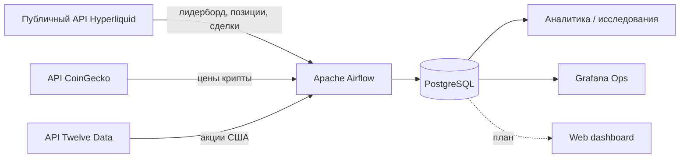
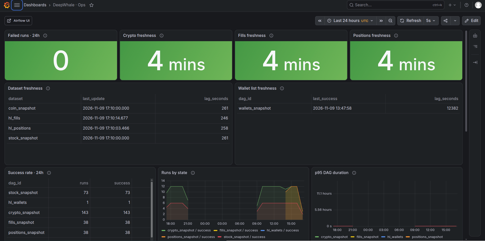
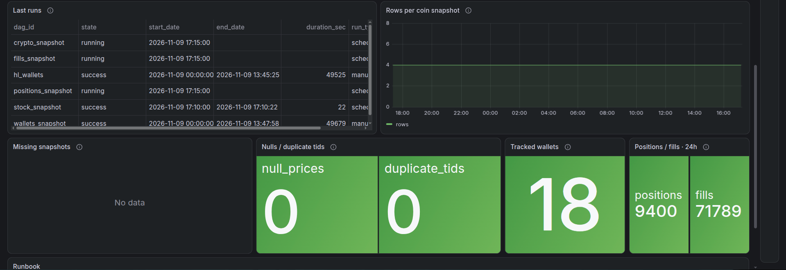
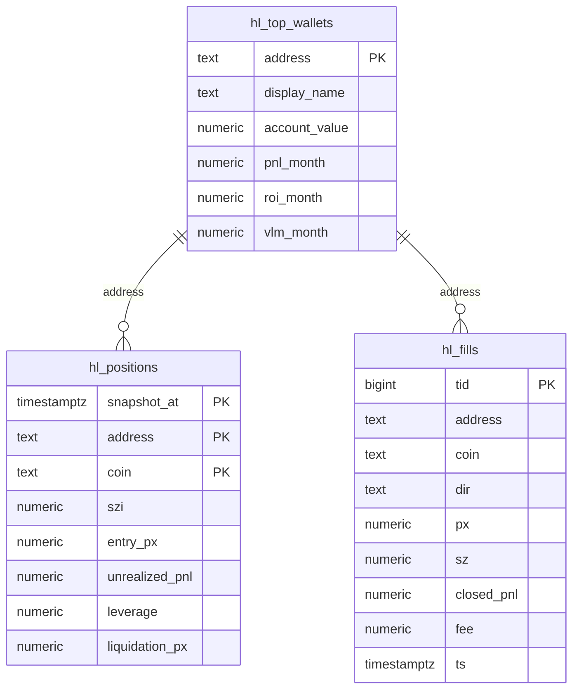
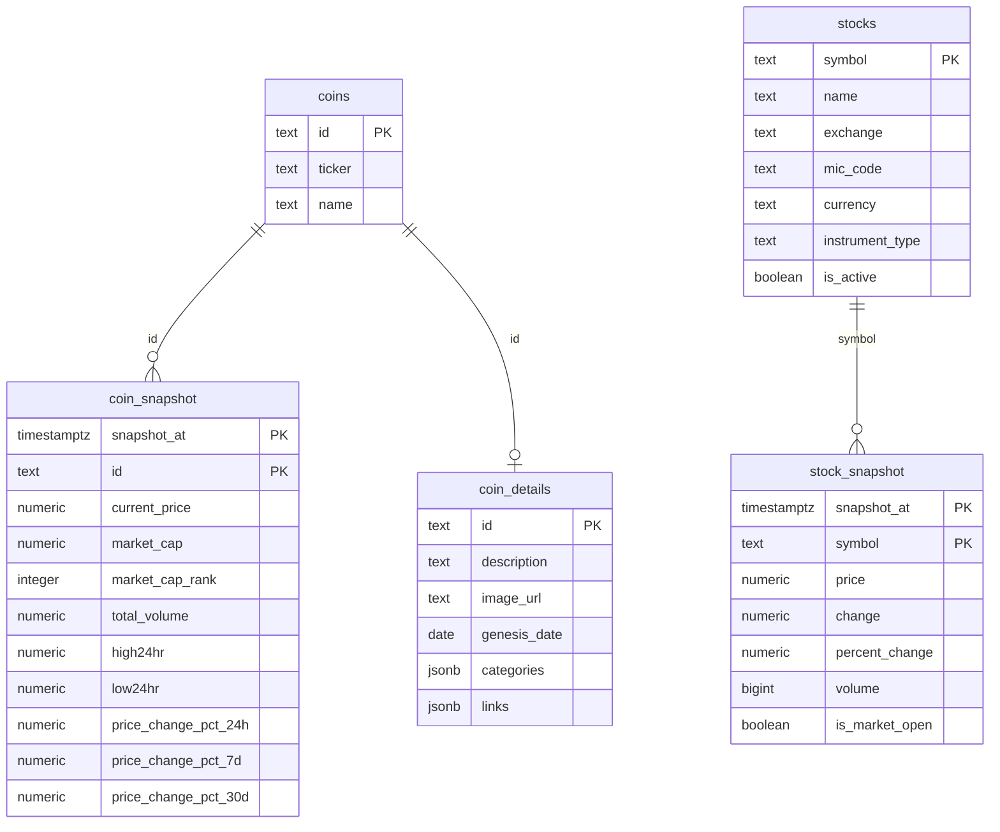

<div align="center">

# DeepWhale

### Следи за деньгами на Hyperliquid.

Открытая платформа для отслеживания самых прибыльных кошельков Hyperliquid: позиций, сделок, PnL и поведения в лонг/шорт. Создана для аналитики и экспериментов со стратегиями следования.

[English version](README.md)


</div>

---

## Зачем DeepWhale?

Hyperliquid — одна из немногих криптобирж, где **весь поток ордеров публичен**. Кошельки псевдонимны, но их позиции и сделки видны в сети. Это даёт редкую возможность:

- видеть, что реально делают лучшие трейдеры;
- измерять их результат, а не догадываться;
- сравнивать текущие позиции с движением цены;
- строить и проверять **стратегии следования** на реальных данных с таймстемпами.

DeepWhale превращает сырые ответы публичного API в чистую базу и аналитический слой.

> Это исследовательский проект, а не инвестиционная рекомендация.

## Что можно делать

- **Находить** топ-кошельки по месячному PnL и размеру счёта.
- **Отслеживать** открытые позиции: размер, направление, цену входа, нереализованный PnL, плечо, цену ликвидации.
- **Анализировать** сделки: реализованный PnL, объём, win rate, направление.
- **Сравнивать** поведение китов с рыночными ценами из CoinGecko.
- **Исследовать** перегруженность лонг/шорт, концентрацию кошельков и доходность стратегий следования.

## Архитектура



Airflow запускает DAG-и загрузки. PostgreSQL — единственный источник правды. Grafana следит за пайплайнами, пользовательский web-дашборд — следующий слой.

## Пайплайны

| DAG | Расписание | Источник | Куда пишет | Зачем |
|---|---|---|---|---|
| `wallets_snapshot` | раз в день, `0 0 * * *` | лидерборд Hyperliquid | `hl_top_wallets` | выбрать топ-10 кошельков по PnL за месяц |
| `positions_snapshot` | каждые 5 минут | `clearinghouseState` | `hl_positions` | снимок открытых позиций топ-10 кошельков |
| `fills_snapshot` | каждые 5 минут | `userFillsByTime` | `hl_fills` | инкрементальная загрузка сделок топ-5 кошельков |
| `crypto_snapshot` | каждые 5 минут | CoinGecko | `coin_snapshot` | снимки BTC / ETH / BNB / GRAM |
| `stock_snapshot` | каждые 10 минут | Twelve Data | `stock_snapshot` | акции США с проверкой календаря NYSE |

Fills загружаются инкрементально: DAG берёт `max(ts)` по кошельку, вычитает 60 секунд перекрытия и отсекает дубли по `tid`. Positions — это снимки: каждый запуск пишет новое состояние каждой открытой позиции.

## Наблюдаемость

Компактный Grafana-дашборд показывает состояние пайплайнов: свежесть данных, здоровье DagRun и базовое качество. Он отделён от пользовательской аналитики по китам.

| Состояние пайплайнов | Качество данных |
|---|---|
|  |  |

## Схема БД

### Hyperliquid-домен



### Таблицы

| Таблица | Гранулярность | За что отвечает |
|---|---|---|
| `hl_top_wallets` | одна строка на кошелёк | текущий месячный топ: имя, equity, PnL, ROI, объём |
| `hl_positions` | кошелёк × монета × снимок | текущий риск: размер, сторона (из `szi`), вход, uPnL, плечо, ликвидация |
| `hl_fills` | одна строка на сделку | неизменяемый лог сделок: направление, цена, размер, реализованный PnL, комиссия, время |

Модель в **3НФ**: никаких вычисляемых `side`, `rank`, `position_value` и `roe` — они считаются в запросах. У `hl_positions` и `hl_fills` есть FK на `hl_top_wallets`.

<details>
<summary><strong>SQL DDL</strong></summary>

```sql
CREATE TABLE hl_top_wallets (
    address        text PRIMARY KEY,
    display_name   text,
    account_value  numeric(30, 6),
    pnl_month      numeric(30, 6),
    roi_month      numeric(20, 10),
    vlm_month      numeric(30, 6)
);

CREATE TABLE hl_positions (
    snapshot_at     timestamptz NOT NULL,
    address         text NOT NULL
                    REFERENCES hl_top_wallets(address) ON DELETE CASCADE,
    coin            text NOT NULL,
    szi             numeric(30, 10),
    entry_px        numeric(30, 10),
    unrealized_pnl  numeric(30, 6),
    leverage        numeric(10, 2),
    liquidation_px  numeric(30, 10),
    PRIMARY KEY (snapshot_at, address, coin)
);

CREATE TABLE hl_fills (
    tid          bigint PRIMARY KEY,
    address      text NOT NULL
                 REFERENCES hl_top_wallets(address) ON DELETE CASCADE,
    coin         text NOT NULL,
    dir          text,
    px           numeric(30, 10),
    sz           numeric(30, 10),
    closed_pnl   numeric(30, 6),
    fee          numeric(30, 6),
    ts           timestamptz NOT NULL
);

CREATE INDEX hl_fills_coin_ts_idx
    ON hl_fills (coin, ts DESC);

CREATE INDEX hl_fills_address_ts_idx
    ON hl_fills (address, ts DESC);

CREATE INDEX hl_positions_coin_snapshot_idx
    ON hl_positions (coin, snapshot_at DESC);
```

</details>

### Рыночные данные



| Таблица | Гранулярность | За что отвечает |
|---|---|---|
| `coins` | одна строка на актив | справочник CoinGecko: id, тикер, название |
| `coin_details` | одна строка на актив | опциональные метаданные: описание, картинка, ссылки, категории |
| `coin_snapshot` | актив × снимок | цена, капитализация, ранг, объём и изменения за 24ч/7д/30д |
| `stocks` | одна строка на тикер | справочник акций США: символ, биржа, валюта, тип |
| `stock_snapshot` | тикер × снимок | цена, изменение, объём и флаг открытой сессии |

<details>
<summary><strong>SQL DDL — рыночные данные</strong></summary>

```sql
CREATE TABLE coins (
    id      text PRIMARY KEY,
    ticker  text NOT NULL,
    name    text NOT NULL
);

CREATE TABLE coin_details (
    id            text PRIMARY KEY REFERENCES coins(id) ON DELETE CASCADE,
    description   text,
    image_url     text,
    genesis_date  date,
    categories    jsonb,
    links         jsonb
);

CREATE TABLE coin_snapshot (
    snapshot_at           timestamptz NOT NULL,
    id                    text NOT NULL REFERENCES coins(id),
    current_price         numeric,
    market_cap            numeric,
    market_cap_rank       integer,
    total_volume          numeric,
    high24hr              numeric,
    low24hr               numeric,
    price_change_pct_24h  numeric,
    price_change_pct_7d   numeric,
    price_change_pct_30d  numeric,
    PRIMARY KEY (id, snapshot_at)
);

CREATE TABLE stocks (
    symbol           text PRIMARY KEY,
    name             text NOT NULL,
    exchange         text NOT NULL,
    mic_code         text,
    currency         text NOT NULL,
    instrument_type  text NOT NULL DEFAULT 'Common Stock',
    is_active        boolean NOT NULL DEFAULT true,
    created_at       timestamptz NOT NULL DEFAULT now(),
    updated_at       timestamptz NOT NULL DEFAULT now()
);

CREATE TABLE stock_snapshot (
    snapshot_at     timestamptz NOT NULL,
    symbol          text NOT NULL REFERENCES stocks(symbol),
    price           numeric(18, 6),
    change          numeric(18, 6),
    percent_change  numeric(10, 4),
    volume          bigint,
    is_market_open  boolean,
    PRIMARY KEY (symbol, snapshot_at)
);
```

</details>

## Стек

| Слой | Инструменты |
|---|---|
| Оркестрация | Apache Airflow 3.3.2 |
| Язык | Python 3.14 |
| Хранение | PostgreSQL |
| Источники | Hyperliquid API, CoinGecko API, Twelve Data API |
| Аналитика | SQL, оконные функции, dimensional modelling |
| Визуализация | Grafana Ops (наблюдаемость); web-дашборд в планах |
| Инструменты | Git, psql, Airflow UI |

## Дашборд

> **Скоро.**

Пользовательский web-дашборд — следующий этап. Планируемые экраны:

- лидерборд китов: PnL, ROI, объём, размер счёта;
- карточка кошелька: открытые позиции, плечо, расстояние до ликвидации, последние сделки;
- рыночный экран: цена BTC/ETH с маркерами лонг/шорт сделок.

Скриншотов web-дашборда пока нет — раздел обновится, когда приложение будет подключено.

## Roadmap

- [x] Поиск кошельков Hyperliquid и месячный рейтинг
- [x] Схема PostgreSQL в 3НФ
- [x] Инкрементальная загрузка fills с дедупликацией
- [x] Снимки позиций и оценка лонг/шорт-экспозиции
- [x] DAG-и для Hyperliquid, CoinGecko и акций США
- [x] Grafana-дашборд наблюдаемости
- [ ] Разметка кошельков и entity resolution
- [ ] Бэктестер стратегий следования: равные веса, risk-adjusted, правила ребалансировки
- [ ] Алерты на резкие изменения позиций
- [ ] Пагинация для кошельков с более чем 2 000 fills за окно
- [ ] Docker Compose и CI

## Ограничения

- Лидерборд Hyperliquid **opt-in** и псевдонимен. Это не все кошельки сети.
- `userFillsByTime` отдаёт максимум **2 000 сделок за ответ** и только **10 000 последних**.
- Чтобы уложиться в лимит **1 200 weight/min**, fills собираются по топ-5 кошелькам, positions — по топ-10.
- История лидерборда API не отдаётся; проект хранит собственные снимки.
- Это исследовательский инструмент, а не торговая система.

## Дисклеймер

DeepWhale — учебный и исследовательский проект. Он не даёт инвестиционных рекомендаций и не исполняет сделки. Публичные on-chain данные могут быть неполными, запаздывать или вводить в заблуждение. Прошлая доходность любого кошелька не гарантирует будущую.

